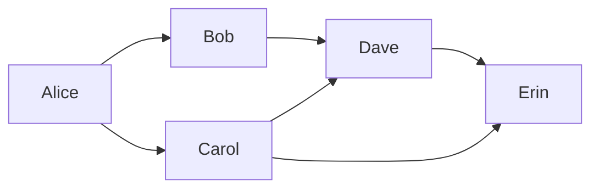

# Graph tutorial: a small social network

This tutorial uses one directed graph in three stores: Neo4j and Apache AGE with Cypher, and HugeGraph with Gremlin. It covers neighborhood exploration, two-hop recommendations, incoming-degree ranking, and a bounded path search. The queries were checked against the versions in [`docker/compose.yaml`](../../docker/compose.yaml).

## Start the lab

Follow the [Docker setup](../../README.md#getting-started), then open:

| Store | Console | Graph used here |
| --- | --- | --- |
| Neo4j | <http://localhost:7474/browser/> | Default `neo4j` database |
| Apache AGE | <http://localhost:5050> (pgAdmin Query Tool) | PostgreSQL database `graphlab`, AGE graph `graph_lab` |
| HugeGraph | <http://localhost:8088> (Hubble Gremlin workbench) | Graph space `DEFAULT`, graph `hugegraph` |

The login details are in `docker/.env`. In pgAdmin, connect to the pre-registered **Apache AGE** server with `AGE_PASSWORD`. In Hubble, sign in as `admin` with `HUGEGRAPH_ADMIN_PASSWORD` and select the `hugegraph` graph in the `DEFAULT` graph space.

## The graph

All six relationships point from the follower to the person followed:



The tutorial owns only the `TutorialPerson`/`FOLLOWS` labels in Neo4j and AGE, and the `tutorial_person`/`tutorial_follows` labels in HugeGraph. The setup below removes existing tutorial vertices before loading the five people again. It leaves other graph data alone.

## Load the data

### Neo4j: Cypher

Run these statements in Neo4j Browser. The first statement makes the tutorial repeatable.

```cypher
MATCH (p:TutorialPerson) DETACH DELETE p;

CREATE (alice:TutorialPerson {name: 'Alice'}),
       (bob:TutorialPerson {name: 'Bob'}),
       (carol:TutorialPerson {name: 'Carol'}),
       (dave:TutorialPerson {name: 'Dave'}),
       (erin:TutorialPerson {name: 'Erin'})
CREATE (alice)-[:FOLLOWS]->(bob),
       (alice)-[:FOLLOWS]->(carol),
       (bob)-[:FOLLOWS]->(dave),
       (carol)-[:FOLLOWS]->(dave),
       (carol)-[:FOLLOWS]->(erin),
       (dave)-[:FOLLOWS]->(erin);
```

### Apache AGE: Cypher inside SQL

Run this entire block in pgAdmin's Query Tool. AGE executes Cypher through PostgreSQL's `cypher()` function. Even a Cypher statement without returned rows needs a declared SQL result column. `LOAD` and `search_path` apply to the current database session; repeat them in a new Query Tool session.

```sql
LOAD 'age';
SET search_path = ag_catalog, "$user", public;

SELECT * FROM cypher('graph_lab', $$
  MATCH (p:TutorialPerson) DETACH DELETE p
$$) AS (ignored agtype);

SELECT * FROM cypher('graph_lab', $$
  CREATE (alice:TutorialPerson {name: 'Alice'}),
         (bob:TutorialPerson {name: 'Bob'}),
         (carol:TutorialPerson {name: 'Carol'}),
         (dave:TutorialPerson {name: 'Dave'}),
         (erin:TutorialPerson {name: 'Erin'})
  CREATE (alice)-[:FOLLOWS]->(bob),
         (alice)-[:FOLLOWS]->(carol),
         (bob)-[:FOLLOWS]->(dave),
         (carol)-[:FOLLOWS]->(dave),
         (carol)-[:FOLLOWS]->(erin),
         (dave)-[:FOLLOWS]->(erin)
$$) AS (ignored agtype);
```

### HugeGraph: Gremlin

HugeGraph requires a schema before inserting data. Run the following blocks in Hubble's Gremlin workbench, one block at a time. The `graph` and `g` bindings refer to the selected graph. The schema calls are safe to repeat.

```groovy
schema = graph.schema()
schema.propertyKey('name').asText().ifNotExist().create()
schema.vertexLabel('tutorial_person').properties('name').primaryKeys('name').ifNotExist().create()
schema.edgeLabel('tutorial_follows').link('tutorial_person', 'tutorial_person').ifNotExist().create()
graph.tx().commit()
```

Load the vertices and directed edges. The first commit completes the deletion before vertices with the same primary keys are added again.

```groovy
g.V().hasLabel('tutorial_person').drop().iterate()
graph.tx().commit()

alice = g.addV('tutorial_person').property('name', 'Alice').next()
bob = g.addV('tutorial_person').property('name', 'Bob').next()
carol = g.addV('tutorial_person').property('name', 'Carol').next()
dave = g.addV('tutorial_person').property('name', 'Dave').next()
erin = g.addV('tutorial_person').property('name', 'Erin').next()

g.V(alice).addE('tutorial_follows').to(bob).iterate()
g.V(alice).addE('tutorial_follows').to(carol).iterate()
g.V(bob).addE('tutorial_follows').to(dave).iterate()
g.V(carol).addE('tutorial_follows').to(dave).iterate()
g.V(carol).addE('tutorial_follows').to(erin).iterate()
g.V(dave).addE('tutorial_follows').to(erin).iterate()
graph.tx().commit()
```

## Recreate or delete the tutorial graph

The social network is a **subgraph** of each store's existing graph or database. To recreate it, run that store's **Load the data** blocks above again. Each setup removes the old tutorial vertices and their relationships before inserting the five people. HugeGraph retains the reusable tutorial schema.

To delete only the tutorial network, run the matching command below. These commands also remove relationships attached to tutorial vertices; they do not delete other vertices or the store itself.

**Neo4j / Cypher**

```cypher
MATCH (p:TutorialPerson) DETACH DELETE p;
```

**Apache AGE / Cypher inside SQL**

```sql
LOAD 'age';
SET search_path = ag_catalog, "$user", public;
SELECT * FROM cypher('graph_lab', $$
  MATCH (p:TutorialPerson) DETACH DELETE p
$$) AS (ignored agtype);
```

**HugeGraph / Gremlin**

```groovy
g.V().hasLabel('tutorial_person').drop().iterate()
graph.tx().commit()
```

If you need to remove the **entire** AGE graph rather than this tutorial network, `SELECT ag_catalog.drop_graph('graph_lab', true);` deletes `graph_lab` and all its labels and data. Create an empty graph again with `SELECT ag_catalog.create_graph('graph_lab');` before rerunning the AGE setup. Neo4j's default database and HugeGraph's `hugegraph` graph are shared by other lab work, so the tutorial cleanup above leaves those containers and graph definitions in place.

## Use case 1: Who does Alice follow?

This is a one-hop, outgoing-neighborhood query. The expected names are **Bob** and **Carol**.

**Neo4j / Cypher**

```cypher
MATCH (alice:TutorialPerson {name: 'Alice'})-[:FOLLOWS]->(other:TutorialPerson)
RETURN other.name AS name
ORDER BY name;
```

**Apache AGE / Cypher inside SQL**

```sql
SELECT * FROM cypher('graph_lab', $$
  MATCH (alice:TutorialPerson {name: 'Alice'})-[:FOLLOWS]->(other:TutorialPerson)
  RETURN other.name
  ORDER BY other.name
$$) AS (name agtype);
```

**HugeGraph / Gremlin**

```groovy
g.V().hasLabel('tutorial_person').has('name', 'Alice')
  .out('tutorial_follows').values('name').order().toList()
```

## Use case 2: Who is two follows away from Alice?

Each two-hop route contributes one count. Dave has **2 routes** (through Bob and Carol); Erin has **1 route** (through Carol). On this dataset, neither is already followed directly by Alice. For a general recommendation feature, also filter out existing direct follows and the starting person.

| Candidate | Routes |
| --- | ---: |
| Dave | 2 |
| Erin | 1 |

**Neo4j / Cypher**

```cypher
MATCH (alice:TutorialPerson {name: 'Alice'})-[:FOLLOWS]->(via:TutorialPerson)-[:FOLLOWS]->(candidate:TutorialPerson)
RETURN candidate.name AS name, count(*) AS routes
ORDER BY routes DESC, name;
```

**Apache AGE / Cypher inside SQL**

```sql
SELECT * FROM cypher('graph_lab', $$
  MATCH (alice:TutorialPerson {name: 'Alice'})-[:FOLLOWS]->(via:TutorialPerson)-[:FOLLOWS]->(candidate:TutorialPerson)
  RETURN candidate.name, count(*) AS routes
  ORDER BY routes DESC, candidate.name
$$) AS (name agtype, routes agtype);
```

**HugeGraph / Gremlin**

```groovy
g.V().hasLabel('tutorial_person').has('name', 'Alice')
  .out('tutorial_follows').out('tutorial_follows')
  .groupCount().by('name').next()
```

Gremlin returns a name-to-route-count mapping. Its entry order is not significant.

## Use case 3: Who has the most followers?

Count incoming `FOLLOWS` edges. Dave and Erin each have **2**; Bob and Carol each have **1**. Alice has no incoming edge and is absent from these results.

**Neo4j / Cypher**

```cypher
MATCH (source:TutorialPerson)-[:FOLLOWS]->(target:TutorialPerson)
RETURN target.name AS name, count(source) AS followers
ORDER BY followers DESC, name;
```

**Apache AGE / Cypher inside SQL**

```sql
SELECT * FROM cypher('graph_lab', $$
  MATCH (source:TutorialPerson)-[:FOLLOWS]->(target:TutorialPerson)
  RETURN target.name, count(source) AS followers
  ORDER BY followers DESC, target.name
$$) AS (name agtype, followers agtype);
```

**HugeGraph / Gremlin**

```groovy
g.V().hasLabel('tutorial_person')
  .out('tutorial_follows').groupCount().by('name').next()
```

## Use case 4: Find a short directed route from Alice to Erin

The shortest route in this graph is **Alice → Carol → Erin**, with **2 hops**. The Cypher examples search paths of 1 to 4 edges and select the shortest. The Gremlin example enumerates cycle-free routes to Erin, orders them by length, and takes the first. These are fine for this small graph; larger graphs need query limits or a dedicated shortest-path facility.

**Neo4j / Cypher**

```cypher
MATCH p = (a:TutorialPerson {name: 'Alice'})-[:FOLLOWS*1..4]->(b:TutorialPerson {name: 'Erin'})
RETURN [n IN nodes(p) | n.name] AS path, length(p) AS hops
ORDER BY hops ASC
LIMIT 1;
```

**Apache AGE / Cypher inside SQL**

```sql
SELECT * FROM cypher('graph_lab', $$
  MATCH p = (a:TutorialPerson {name: 'Alice'})-[:FOLLOWS*1..4]->(b:TutorialPerson {name: 'Erin'})
  RETURN p, length(p) AS hops
  ORDER BY hops ASC
  LIMIT 1
$$) AS (path agtype, hops agtype);
```

AGE returns the path as an `agtype` value containing vertices and edges. Read the vertices' `name` properties in order; the last column is `2`. Neo4j can project the names into a list directly. That list projection did not work with the AGE version used here, so the AGE example returns the path itself.

**HugeGraph / Gremlin**

```groovy
g.V().hasLabel('tutorial_person').has('name', 'Alice')
  .repeat(__.out('tutorial_follows').simplePath())
  .until(__.has('name', 'Erin'))
  .path().by('name')
  .order().by(__.count(local), asc)
  .limit(1).toList()
```

## What to compare

- **Direction matters:** `out('tutorial_follows')` corresponds to Cypher's outgoing `-[:FOLLOWS]->` pattern. Reverse it to inspect followers of a person.
- **Aggregation differs in shape:** Cypher returns rows with named columns; Gremlin's `groupCount()` returns a mapping.
- **AGE adds a SQL boundary:** the Cypher text is inside `cypher()`, and each returned item needs an `agtype` column declaration. AGE values may display with `::vertex`, `::edge`, or `::path` annotations.
- **HugeGraph requires schema:** create property, vertex, and edge labels before the Gremlin data load.

## References

- [Apache AGE Cypher query format](https://age.apache.org/age-manual/master/intro/cypher.html), [graph lifecycle](https://age.apache.org/age-manual/master/intro/graphs.html), and [variable-length matching](https://age.apache.org/age-manual/master/clauses/match.html)
- [Neo4j Cypher path matching](https://neo4j.com/docs/cypher-manual/current/patterns/shortest-paths/)
- [HugeGraph schema and Gremlin examples](https://hugegraph.apache.org/docs/language/hugegraph-example/) and [Hubble quick start](https://hugegraph.apache.org/docs/quickstart/toolchain/hugegraph-hubble/)
